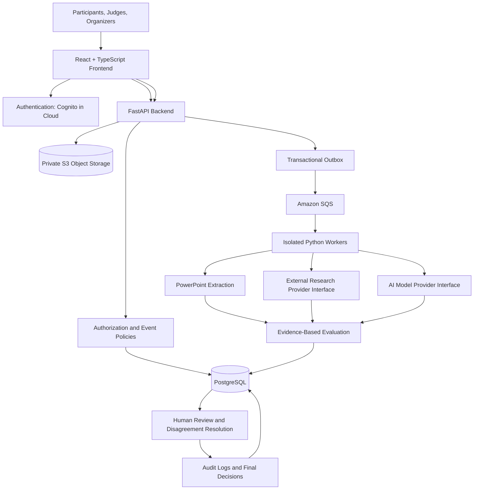

# VentureLens AI
## Architecture and Design Baseline — Version 1.0

**Official Project Title:** AI-Powered Hackathon Project Evaluation, Research & Shortlisting Platform

**Tagline:** Evidence-Driven Evaluation. Fairer Decisions. Human-Led Selection.

**Document Status:** Architecture and Design Baseline Completed

**Version:** 1.0

---

# 1. Project Overview

## 1.1 Problem Statement

Hackathon organizers often evaluate hundreds of project submissions using PowerPoint presentations, GitHub repositories, research materials, and manual judging processes.

Traditional evaluation approaches can suffer from:

- Inconsistent scoring between judges.
- Time-consuming manual research.
- Difficulty validating project claims.
- Limited visibility into technical feasibility.
- Subjective novelty and innovation assessments.
- Inconsistent application of eligibility rules.
- Difficulty identifying duplicate or highly similar submissions.
- Poor traceability of scoring decisions.
- Delays in shortlisting and result publication.

VentureLens AI aims to address these problems by providing an AI-assisted, evidence-driven evaluation and shortlisting platform.

The platform will analyze submitted materials, conduct external research, assess predefined criteria, provide explainable provisional scores, and support human reviewers in making final decisions.

## 1.2 Proposed Solution

VentureLens AI will provide a centralized platform where organizers create hackathon events, configure evaluation rubrics, manage participants, assign judges, and oversee the evaluation process.

Participants will register through event-specific links and submit their project presentations and supporting materials directly through the platform.

The system will:

1. Validate submitted materials and event eligibility.
2. Extract relevant information from PowerPoint presentations.
3. Inspect optional or mandatory GitHub repositories according to event policy.
4. Research existing solutions and relevant technical evidence.
5. Evaluate projects against a versioned rubric.
6. Produce criterion-level provisional scores with evidence and explanations.
7. Assign projects to judges and collect independent human reviews.
8. Flag material disagreements and incomplete evidence.
9. Enforce event-specific eligibility and finalization rules.
10. Generate authorized rankings, reports, and participant feedback.

**Core principle:** AI assists evaluation; authorized humans retain final decision-making authority.

## 1.3 Business Value

VentureLens AI is intended to deliver:

- Reduced manual research and evaluation effort.
- More consistent application of published rubrics.
- Better evidence traceability for scoring decisions.
- Improved visibility into technical feasibility and existing solutions.
- Structured disagreement resolution.
- More transparent and auditable shortlisting.
- Reusable evaluation workflows across multiple events.
- Better-quality feedback for participants.

The platform will not claim to eliminate bias or prove that a project is objectively novel. These limitations must be communicated clearly.

## 1.4 Target Users

### Event Organizers
Create events, configure policies, publish rubrics, manage deadlines, assign judges, resolve exceptions, and publish results.

### Participants and Teams
Register for events, form teams, submit project materials, monitor evaluation status, and receive authorized feedback.

### Judges and Reviewers
Review submissions independently, assess criteria, document reasoning, declare conflicts of interest, and participate in disagreement resolution.

### Authorized Administrators
Manage platform-level operations, access controls, retention policies, and operational health.

---

# 2. Project Scope

## 2.1 Version 1 Scope

### Event Management
- Organization and membership management.
- Event creation and configuration.
- Registration capacity and team-size limits.
- Event-specific submission links.
- Configurable registration and submission deadlines.
- Manual or automatic workflow transitions.

### Evaluation Rubrics
- Predefined evaluation templates.
- Customizable templates.
- Rubric creation from scratch.
- Custom evaluation criteria.
- Organizer-configurable criterion weights.
- Mandatory criteria and minimum score thresholds.
- Rubric versioning and publication.
- Rubric immutability after submissions open, except through controlled, documented exceptions.

### Submission Management
- PowerPoint submission.
- Versioned submissions.
- Optional or mandatory GitHub repository links.
- Submission validation.
- Missing-material notifications.
- Configurable late-submission policies.
- Private storage for uploaded artifacts.

### AI-Assisted Evaluation
- PowerPoint text and table extraction.
- Relevant visual analysis where technically feasible.
- Repository metadata and static-file inspection.
- External research into existing solutions and technical claims.
- Criterion-level provisional scores.
- Evidence-linked rationales.
- Strengths, weaknesses, uncertainty, and evidence-gap reporting.
- Duplicate and similarity detection.
- Processing-stage tracking.

### Human Review
- Independent-first judging.
- Configurable anonymous or identity-visible review.
- Judge assignments and conflict-of-interest checks.
- Criterion-level score overrides with written justification.
- Material-disagreement escalation.
- Eligibility exception handling.
- Appeals where enabled by event policy.
- Final decision history.

### Results and Reporting
- Authorized rankings and result publication.
- Domain- or category-specific comparisons.
- Exportable results.
- Participant feedback.
- Audit history.

## 2.2 Explicitly Out of Scope for Version 1

- Executing untrusted participant code on the application server.
- Automatic proof of project originality or ownership.
- Fully autonomous winner selection.
- Unrestricted cross-domain project rankings.
- Guaranteed elimination of evaluator bias.
- Mandatory paid AI inference.
- Automatic paid-provider fallback when free research quotas are exhausted.

Runtime testing of participant repositories may be considered in a later version using a separately designed, isolated sandbox.

---

# 3. Functional Requirements

## 3.1 Organization and Event Management

- Organizations can manage authorized members and their roles.
- Organizers can create and configure events.
- Events have configurable registration windows and submission deadlines.
- Registration capacity, team-size limits, and optional waitlists are supported.
- Events can define their own evaluation policies.
- Every important state transition is logged.

## 3.2 Registration and Team Management

- Participants register through an event-specific platform link.
- Participants can form teams according to event rules.
- The platform enforces registration capacity and team-size constraints.
- Team members must belong to the correct event.
- Duplicate or conflicting active membership must be prevented.

## 3.3 Submission Management

- Participants upload PowerPoint presentations.
- Each submission can have multiple immutable versions.
- The current version must belong to the corresponding submission.
- Each uploaded file receives a content hash for integrity and duplicate analysis.
- Submission artifacts are stored privately.
- The platform validates file type, size, access, and processing status.
- GitHub repository requirements follow the event's published policy.

## 3.4 Rubric Management

- Rubrics contain criteria with configurable weights.
- Criterion weights must total exactly 100 before publication.
- Published rubrics are immutable under normal operations.
- Changes require a controlled, documented exception and version history.
- Copying a template creates an independent event-specific rubric.
- Score bounds and required-criterion rules are validated before publication.

## 3.5 Research and Evaluation

- Each evaluation references a specific submission version and rubric version.
- Research sources record their URLs, titles, retrieval times, and quality assessments.
- Research quality considers authority, relevance, recency, and corroboration.
- Contradictory evidence is surfaced rather than silently discarded.
- Incomplete research must not be interpreted as negative evidence.
- The AI must not invent scores when evidence is insufficient.
- Processing failures are recorded and recoverable failures are retried within configured limits.

## 3.6 Human Review and Finalization

- Judges submit their independent assessments before seeing AI scores.
- Judge assignments must respect conflicts of interest.
- Material disagreement requires independent review.
- Human overrides require a written justification and audit record.
- Eligibility, required reviews, research requirements, and event policies must be satisfied before finalization.
- The final decision is separate from the AI-generated score.
- Historical decisions are preserved.

---

# 4. Evaluation Rubric and Scoring Policy

## 4.1 Scoring Scale

Each assessable criterion uses a fixed integer scale from 0 to 5.

| Score | Meaning |
|---|---|
| 0 | No relevant evidence or criterion not addressed |
| 1 | Very weak evidence or performance |
| 2 | Limited evidence or performance |
| 3 | Adequate evidence or performance |
| 4 | Strong evidence or performance |
| 5 | Excellent, well-supported evidence or performance |

A score of 0 does not prove that a project is bad. It indicates that the criterion has not been adequately demonstrated in the evaluated material.

## 4.2 Not Assessable

A criterion may be marked **Not Assessable** when there is insufficient evidence or a technical failure prevents a valid assessment.

The reviewer must provide an explanation.

Not Assessable is distinct from 0. It cannot be silently converted to zero, and an unresolved Not Assessable result blocks finalization when the criterion is required.

## 4.3 Weighted Score

For a rubric containing criteria \(i=1,\ldots,n\), let:

- \(w_i\) be the criterion weight.
- \(s_i\) be the score from 0 to 5.
- The weights total 100.

The normalized weighted score is:

\[
S=\sum_{i=1}^{n} \frac{w_i s_i}{5}
\]

This produces a score on a 0–100 scale.

The final score is calculated only when the applicable policy for missing or Not Assessable criteria has been resolved. The system must not silently renormalize weights or invent missing scores.

## 4.4 Innovation Assessment

Innovation is assessed through evidence-based differentiation.

The platform will:

- Identify related existing solutions.
- Compare the project's stated features and approach.
- Highlight similarities and differences.
- Identify evidence supporting differentiation.
- Disclose uncertainty and research limitations.

The existence of competitors does not automatically reduce a project's score. Research cannot conclusively prove novelty.

## 4.5 Eligibility Versus Quality

Eligibility is evaluated separately from project quality.

A technically strong submission may still be ineligible under published event rules. An eligible submission may still receive a low quality score.

The platform must not merge these decisions into a single opaque score.

## 4.6 Thresholds and Tie-Breaking

Organizers can configure:

- Overall minimum score.
- Optional criterion-specific minimum scores.
- Published eligibility thresholds.
- Tie-break criteria.
- Material-disagreement thresholds.

These rules must be published before submissions open and must not be changed selectively for individual participants.

---

# 5. Architecture

## 5.1 Architecture Overview

VentureLens AI will use a modular architecture with a React frontend, FastAPI backend, PostgreSQL database, private S3 object storage, asynchronous processing through SQS, and isolated worker processes.

The architecture separates user-facing requests from long-running document extraction, research, and AI evaluation.

## 5.2 Technology Stack

| Layer | Technology | Responsibility |
|---|---|---|
| Frontend | React + TypeScript | User interface and event workflows |
| Backend API | Python + FastAPI | Business logic and API contracts |
| Database | PostgreSQL | Persistent application data |
| ORM | SQLAlchemy 2.x | Database access and models |
| Migrations | Alembic | Version-controlled schema changes |
| Object storage | Amazon S3 | Private submission and artifact storage |
| Job queue | Amazon SQS | Asynchronous processing requests |
| Workers | Python worker processes | Extraction, research, and evaluation |
| Authentication | Amazon Cognito | Cloud identity authentication |
| Application authorization | VentureLens AI backend | Organization, event, and role permissions |
| Frontend hosting | AWS Amplify | Cloud frontend hosting |
| API hosting | Amazon ECS + AWS Fargate | Containerized backend API |
| Worker hosting | Amazon ECS + AWS Fargate | Separate evaluation workers |
| Local AI | Ollama + open-weight model | Default local inference |
| Research | Replaceable provider interface | External source discovery |
| Testing | pytest + integration tests | Automated validation |
| Version control | Git + GitHub | Collaboration and release history |

The exact local AI model will be selected after checking the development machine's hardware. No specific model's performance is assumed in this baseline.

## 5.3 Logical Architecture Diagram



## 5.4 Component Responsibilities

### Frontend
- Registration, submission, event setup, and judge interfaces.
- Rubric configuration and visualization.
- Processing progress.
- Evidence review and score explanations.
- Result and feedback presentation.

### Backend API
- Authentication integration.
- Authorization and policy enforcement.
- Input validation.
- Event, registration, team, rubric, submission, and review workflows.
- Signed upload URL generation where appropriate.
- Job creation and status reporting.
- Finalization gates.

### PostgreSQL
- Source of truth for business data.
- Event and rubric versioning.
- Scores, research metadata, reviews, decisions, and audit history.
- Processing and transactional outbox records.

### S3
- Private storage for uploaded presentations and derived artifacts.
- Access through authorized backend operations or short-lived signed URLs.
- No public access by default.

### SQS and Workers
- Long-running processing is asynchronous.
- Worker retries are bounded.
- Failed messages can be sent to a dead-letter queue.
- Workers must be idempotent because queue delivery can occur more than once.

### AI and Research Interfaces
- Model and research providers are replaceable.
- Provider-specific implementations must not leak into business logic.
- Paid services are not silently enabled as fallback providers.

---

# 6. Architecture Principles

1. **Human authority:** AI scores are provisional, not final decisions.
2. **Evidence first:** Every score should have a traceable rationale and relevant evidence.
3. **Reproducibility:** Record rubric, prompt, model/provider, and configuration versions.
4. **Version immutability:** Published rubrics and submitted versions are preserved.
5. **Security by default:** Untrusted uploads and repositories are never treated as trusted instructions or executable code.
6. **Least privilege:** Users can access only authorized organizations, events, and records.
7. **Asynchronous processing:** Long-running tasks do not block API requests.
8. **Provider independence:** AI and research providers use replaceable internal interfaces.
9. **Auditability:** Overrides, exceptions, assignments, appeals, and final decisions are logged.
10. **Cost awareness:** Local development and free/open-source tooling are preferred where practical.
11. **Failure transparency:** Incomplete evidence or failed processing must be visible.
12. **No fabricated evidence:** A provider failure cannot justify inventing research findings or scores.

---

# 7. Repository Structure

The following is the target repository layout. It is a design specification; files will be created incrementally.

```text
venturelens-ai/
├── frontend/
│   ├── src/
│   ├── public/
│   ├── tests/
│   └── package.json
│
├── backend/
│   ├── app/
│   │   ├── api/
│   │   ├── core/
│   │   ├── models/
│   │   ├── schemas/
│   │   ├── services/
│   │   ├── evaluation/
│   │   ├── research/
│   │   ├── repositories/
│   │   └── workers/
│   ├── migrations/
│   ├── tests/
│   └── pyproject.toml
│
├── evaluation/
│   ├── prompts/
│   ├── rubrics/
│   └── benchmarks/
│
├── infrastructure/
│   ├── aws/
│   └── docker/
│
├── docs/
│   ├── architecture/
│   ├── api/
│   ├── database/
│   └── decisions/
│
├── scripts/
├── .env.example
├── .gitignore
├── Dockerfile
├── docker-compose.yml
└── README.md
```

The frontend and backend remain separated so each can be developed, tested, built, and deployed independently.

---

# 8. Database Design

## 8.1 Database Conventions

- Primary identifiers use UUIDs.
- Timestamps use `TIMESTAMPTZ`.
- Critical statuses use `TEXT` with `CHECK` constraints where appropriate.
- `JSONB` is reserved for genuinely flexible configuration and structured details.
- Foreign keys enforce relationships.
- `ON DELETE RESTRICT` is the default; deletion and retention are explicit workflows.
- Rubric weights use `NUMERIC(5,2)`.
- Criterion scores use `SMALLINT`.
- Final scores use `NUMERIC(6,3)`.
- Published rubrics and submission versions are immutable.
- Foreign-key columns and common query patterns receive appropriate indexes.
- Cross-event and cross-rubric relationships require composite foreign keys or equivalent database validation.

## 8.2 Identity and Organization Tables

### `users`
- `id UUID PRIMARY KEY`
- `cognito_subject TEXT UNIQUE NOT NULL`
- `email TEXT NOT NULL`
- `status TEXT NOT NULL`
- `created_at TIMESTAMPTZ`
- `updated_at TIMESTAMPTZ`

### `organizations`
- `id UUID PRIMARY KEY`
- `name VARCHAR(200) NOT NULL`
- `status TEXT NOT NULL`
- `created_at TIMESTAMPTZ`
- `updated_at TIMESTAMPTZ`

### `memberships`
- `id UUID PRIMARY KEY`
- `organization_id UUID REFERENCES organizations(id)`
- `user_id UUID REFERENCES users(id)`
- `role TEXT NOT NULL`
- `status TEXT NOT NULL`
- `created_at TIMESTAMPTZ`
- Unique `(organization_id, user_id)`

## 8.3 Event and Participation Tables

### `events`
- `id UUID PRIMARY KEY`
- `organization_id UUID REFERENCES organizations(id)`
- `name VARCHAR(200) NOT NULL`
- `description TEXT`
- `status TEXT NOT NULL`
- `settings JSONB NOT NULL DEFAULT '{}'`
- `registration_opens_at TIMESTAMPTZ`
- `registration_closes_at TIMESTAMPTZ`
- `submission_deadline TIMESTAMPTZ`
- `created_at TIMESTAMPTZ`
- `updated_at TIMESTAMPTZ`

### `registrations`
- `id UUID PRIMARY KEY`
- `event_id UUID REFERENCES events(id)`
- `user_id UUID REFERENCES users(id)`
- `status TEXT NOT NULL`
- `registered_at TIMESTAMPTZ`
- Unique `(event_id, user_id)`

### `teams`
- `id UUID PRIMARY KEY`
- `event_id UUID REFERENCES events(id)`
- `name VARCHAR(150) NOT NULL`
- `status TEXT NOT NULL`
- `created_at TIMESTAMPTZ`

### `team_memberships`
- `id UUID PRIMARY KEY`
- `team_id UUID REFERENCES teams(id)`
- `registration_id UUID REFERENCES registrations(id)`
- `joined_at TIMESTAMPTZ`
- `left_at TIMESTAMPTZ NULL`

A partial unique index prevents duplicate active membership. Team and registration event consistency must also be enforced.

## 8.4 Template and Rubric Tables

### `event_templates`
Stores built-in and organization-specific templates.

### `event_template_versions`
Stores immutable, versioned template configuration.

### `template_criteria`
Stores default criterion names, descriptions, weights, and required flags.

### `rubric_versions`
Stores event-specific rubric versions and publication state.

### `rubric_criteria`
Stores the criteria and weights for each event rubric version.

Important constraints:

- Criterion weights must be positive and no greater than 100.
- Criterion score bounds must remain within 0–5.
- Minimum score cannot exceed maximum score.
- Weights must total exactly 100 when publishing a rubric.
- Weight totals require publication-time transactional validation; a row-level `CHECK` alone is insufficient.
- Each evaluation must use criteria belonging to its referenced rubric version.

## 8.5 Submission Tables

### `submissions`
Stores the logical submission for a team and event, including current version reference and status.

### `submission_versions`
Stores immutable versions of uploaded presentations.

Important fields include:

- `submission_id`
- `version_number`
- `ppt_object_key`
- `sha256`
- `uploaded_at`
- `eligibility_status`

Unique constraints protect submission version numbering and version identity.

A composite foreign key ensures `current_version_id` belongs to the same submission.

### `submission_artifacts`
Stores references to extracted text, processed document data, and other derived artifacts.

Files themselves are stored in private object storage, not directly in PostgreSQL.

## 8.6 Evaluation and Research Tables

### `evaluations`
Records the evaluation of a specific submission version using a specific rubric version.

Stores status, provider, model version, prompt version, configuration, and timestamps.

### `criterion_scores`
Stores one score or Not Assessable result per evaluation criterion, along with rationale and uncertainty.

### `research_runs`
Tracks external research attempts, status, provider, timing, and error codes.

### `research_sources`
Stores source URLs, titles, retrieval timestamps, quality assessments, and limitations.

### `score_evidence`
Connects criterion scores to relevant sources, slide numbers, excerpts, and relevance explanations.

Important constraints:

- Scores must be between 0 and 5 when assessable.
- Not Assessable scores must be NULL.
- Every criterion must belong to the evaluation's rubric version.
- Source quality scores must remain between 0 and 1.
- Slide numbers, when present, must be positive.
- Incomplete research cannot be interpreted as negative evidence.

## 8.7 Judge Review and Decision Tables

### `judge_assignments`
Tracks judge assignments, assignment status, and assigning user.

### `judge_reviews`
Stores each judge's independent review cycle.

### `judge_criterion_scores`
Stores judge-specific criterion scores and rationale.

### `disagreement_reviews`
Tracks material disagreement review, reviewer, resolution, justification, and resolution time.

### `final_decisions`
Stores versioned final decisions, final scores, ranks, justifications, finalizing users, and timestamps.

Final decisions preserve historical versions. Only one current finalized decision per submission should be active, and rank uniqueness must be enforced at the relevant event publication scope.

## 8.8 Governance Tables

### `eligibility_checks`
Stores rule-level eligibility results and reasons.

### `eligibility_exceptions`
Records authorized exceptions and written justification.

### `conflict_declarations`
Stores judge conflict-of-interest declarations.

### `duplicate_findings`
Records potentially duplicated or highly similar submissions and the evidence used.

### `appeals`
Stores participant appeals, grounds, deadlines, and status.

### `appeal_reviews`
Stores authorized appeal decisions and justification.

### `feedback_releases`
Stores authorized participant feedback releases.

### `result_publications`
Tracks result publication events and status.

### `processing_jobs`
Tracks asynchronous job state, retry count, next retry time, and completion.

### `processing_stage_runs`
Tracks validation, extraction, research, evaluation, review, and other processing stages.

### `outbox_events`
Provides reliable dispatch of database-backed events to the asynchronous queue.

### `audit_logs`
Stores actor, action, entity, timestamp, and relevant details. Normal application operations must not modify or delete audit history.

### `retention_policies`
Defines retention duration and action by data category and organizational scope.

### `retention_actions`
Records deletion, anonymization, and other retention operations.

### `legal_holds`
Prevents eligible data from being removed while a documented hold is active.

### `idempotency_records`
Prevents accidental duplicate processing of retryable API requests.

Additional event-policy configuration must support published tie-break rules, late-submission policy, thresholds, appeals, anonymous review, and workflow settings. Relationships should remain relational rather than being placed indiscriminately in JSONB.

## 8.9 Index Strategy

Create indexes for actual lookup and workflow patterns, including:

- Unique organization membership.
- Events by organization and status.
- Events by status and submission deadline.
- Registrations by event and user.
- Active team memberships.
- Submission versions by submission and version number.
- Evaluations by submission version and rubric version.
- Processing jobs by status and retry time.
- Unpublished outbox events by creation time.
- Judge assignments by judge and status.
- Audit logs by entity and occurrence time.
- Appeals by submission and status.
- Duplicate findings by event and review status.

Do not add an index to every column without a query or integrity justification.

## 8.10 Migration Order

1. Users, organizations, and memberships.
2. Events, registrations, teams, and team memberships.
3. Templates, submissions, versions, rubrics, criteria, and artifacts.
4. Evaluations, research, evidence, judge assignments, and reviews.
5. Eligibility, conflicts, duplicate findings, appeals, decisions, feedback, and publications.
6. Processing jobs, stage history, outbox, idempotency, audit, retention, and legal holds.
7. Composite foreign keys, partial unique indexes, status constraints, performance indexes, and migration tests.

Once a migration has been shared or deployed, do not edit it in place. Add a new migration to change the schema.

---

# 9. API Design

## 9.1 API Conventions

- Base path: `/api/v1`
- Format: JSON
- Identifiers: UUID
- Timestamps: UTC ISO 8601
- Pagination: cursor-based for potentially large result sets
- Authentication: Cognito in cloud deployments
- Authorization: enforced server-side by organization, event, and role
- Long-running jobs: return `202 Accepted`
- Retryable creation requests: support idempotency keys
- API responses must not expose secrets or internal stack traces.

Standard error format:

```json
{
  "error": {
    "code": "INVALID_STATE_TRANSITION",
    "message": "The requested action is not permitted in the current state.",
    "request_id": "request-correlation-id"
  }
}
```

## 9.2 Identity and Organization APIs

- `GET /api/v1/users/me`
- `POST /api/v1/organizations`
- `GET /api/v1/organizations/{organization_id}`
- `POST /api/v1/organizations/{organization_id}/memberships`

## 9.3 Event and Participation APIs

- `POST /api/v1/organizations/{organization_id}/events`
- `GET /api/v1/events/{event_id}`
- `PATCH /api/v1/events/{event_id}`
- `POST /api/v1/events/{event_id}/registrations`
- `POST /api/v1/events/{event_id}/teams`
- `POST /api/v1/teams/{team_id}/members`

## 9.4 Template and Rubric APIs

- `GET /api/v1/templates`
- `POST /api/v1/templates`
- `POST /api/v1/templates/{template_id}/versions`
- `GET /api/v1/templates/{template_id}/versions`
- `POST /api/v1/events/{event_id}/rubric-versions`
- `POST /api/v1/rubric-versions/{rubric_version_id}/publish`
- `GET /api/v1/rubric-versions/{rubric_version_id}`

Publishing validates that weights total 100, criteria are valid, and required event policies are defined.

## 9.5 Submission APIs

- Initiate upload.
- Complete upload.
- `POST /api/v1/events/{event_id}/submissions`
- `POST /api/v1/submissions/{submission_id}/versions`
- `GET /api/v1/submissions/{submission_id}/status`

Upload initiation and completion must validate authorization, file constraints, object ownership, and version integrity.

## 9.6 Evaluation APIs

- `POST /api/v1/submissions/{submission_id}/evaluations`
- `GET /api/v1/evaluations/{evaluation_id}`
- `GET /api/v1/evaluations/{evaluation_id}/evidence`
- Retrieve processing-stage history.

Evaluation creation must identify the exact submission version and rubric version. The API returns an evaluation/job identifier and current status instead of waiting for the entire evaluation to finish.

## 9.7 Human Review APIs

- Submit judge review.
- Retrieve assigned submissions.
- Declare conflicts of interest.
- Reassign conflicting judges.
- Create and resolve disagreement reviews.
- Resolve eligibility exceptions.
- Review duplicate findings.
- Submit and review appeals.

All operations require authorization and valid workflow state.

## 9.8 Finalization and Results APIs

- `POST /api/v1/submissions/{submission_id}/finalize`
- `GET /api/v1/events/{event_id}/results`
- Publish results.
- Release participant feedback.
- Retrieve authorized audit logs.
- Export authorized event results.

The finalization endpoint must calculate and verify the result server-side. It must never trust a client-supplied final score or rank.

## 9.9 HTTP Status Codes

- `400`: Invalid request structure or parameter.
- `401`: Unauthenticated request.
- `403`: Insufficient permissions.
- `404`: Resource not found or not visible to caller.
- `409`: Invalid workflow transition or conflicting update.
- `422`: Validation failure.
- `429`: Rate limit exceeded.
- `500`: Unexpected server error.

---

# 10. Security and Privacy

## 10.1 Authentication and Authorization

- Use Cognito for cloud authentication.
- Keep local development authentication separate and explicitly development-only.
- Enforce role-based and event-level authorization in the backend.
- Never rely on frontend visibility controls as the security boundary.
- Restrict administrative and finalization permissions.

## 10.2 Upload Security

- Store files privately.
- Validate file type, size, and content.
- Generate unpredictable object keys.
- Use short-lived signed URLs when appropriate.
- Do not trust filenames or file extensions.
- Prevent unauthorized access to other events' submissions.

## 10.3 Repository Security

- Treat all repository content as untrusted.
- Inspect static files only in Version 1.
- Never execute participant code on the application server.
- Defend against prompt injection in presentations, repository files, and web content.
- Keep retrieved content separate from system instructions.

## 10.4 Secrets and Configuration

- Keep credentials out of Git.
- Commit `.env.example` with placeholders, not real secrets.
- Use an appropriate secrets manager for cloud deployments.
- Apply least-privilege service permissions.
- Avoid logging access tokens, credentials, or unnecessary personal data.

## 10.5 Auditability and Retention

- Record score overrides, assignments, exceptions, appeals, and finalization.
- Preserve original decisions when a later decision changes the outcome.
- Define retention periods by data category.
- Apply documented deletion or anonymization workflows.
- Respect legal holds.
- Restrict audit-log modification and access.

## 10.6 Fairness and Conflicts

- Judges declare conflicts of interest.
- Conflicted assignments are blocked or reassigned.
- Similarity detection produces flags, not automatic penalties.
- Benchmark AI output against human-reviewed examples.
- Monitor disagreement and evidence-quality patterns.
- Do not claim that automation eliminates bias.

---

# 11. Reliability and Asynchronous Processing

## 11.1 Processing Workflow

A submission follows the general workflow:

`Draft → Submitted → Validation → Extraction → Research → AI Evaluation → Human Review → Disagreement Resolution (if required) → Finalization`

Some stages may run concurrently where dependencies allow, but all required gates must be satisfied before finalization.

## 11.2 Transactional Outbox Pattern

When the backend creates an evaluation job, it writes the business record and an outbox event in the same PostgreSQL transaction.

A publisher then sends the event to SQS and records publication progress.

This avoids losing queue messages when a database transaction succeeds but message publication fails.

## 11.3 Retry and Idempotency

- Recoverable errors receive bounded retries.
- Workers must be idempotent.
- Duplicate queue delivery must not create duplicate final decisions or scores.
- Repeated API requests with the same idempotency key must not accidentally start duplicate operations.
- Messages that repeatedly fail are sent to a dead-letter queue.
- Failures and retry history remain observable.

The queue is treated as at-least-once delivery; exactly-once processing is not assumed.

## 11.4 Evaluation Quality Safeguards

- Incomplete research is visible.
- Missing evidence is not fabricated.
- Essential processing failures trigger human review.
- Benchmark quality thresholds can pause affected evaluations.
- Model/provider changes are tracked.
- Authorized approval is required before resuming evaluations after a quality-related pause.

---

# 12. Testing Strategy

## 12.1 Unit Tests

Test:

- Weight-total validation.
- Score bounds.
- Eligibility rules.
- Team and event consistency.
- Rubric immutability.
- Workflow transitions.
- Finalization gates.
- Conflict-of-interest checks.
- Idempotency behavior.

## 12.2 Database and Migration Tests

Test:

- Migrations on a clean database.
- Upgrade from the previous schema.
- Foreign-key integrity.
- Composite relationship constraints.
- Partial unique indexes.
- Cross-event relationship prevention.
- Published rubric immutability.
- Transactional publication validation.
- Rollback and recovery behavior where supported.

## 12.3 API Integration Tests

Test:

- Authentication and authorization.
- Organization isolation.
- Event creation and configuration.
- Registration and team workflows.
- Rubric creation and publication.
- Submission upload initiation and completion.
- Evaluation job creation and status retrieval.
- Judge review submission.
- Result finalization and publication.

## 12.4 AI Evaluation Tests

Use a curated, human-reviewed benchmark set.

Measure:

- Score agreement with human reviewers.
- Evidence relevance and traceability.
- Unsupported-claim rate.
- Not Assessable handling.
- Research source quality.
- Contradictory evidence handling.
- Repeatability and provider failure behavior.
- Prompt-injection resistance.

The benchmark must record its rubric and dataset versions. Performance claims must be supported by measured results.

## 12.5 Security Tests

Test:

- Cross-organization data access.
- Unauthorized result access.
- Upload validation.
- Signed URL expiration and scope.
- Prompt injection in documents and repository files.
- Secret leakage in logs and error messages.
- Conflict-of-interest enforcement.
- Audit-log protection.
- Abuse of administrative endpoints.

## 12.6 Workflow Tests

Verify that finalization is blocked when:

- Eligibility remains unresolved.
- Required reviews are missing.
- Material disagreement is unresolved.
- Required research is incomplete without an authorized exception.
- A required criterion remains Not Assessable.
- Event-specific finalization conditions are unmet.

Also verify that valid exceptions are documented and authorized.

---

# 13. Deployment Strategy

## 13.1 Development Environment

The initial environment will use:

- Local Python environment.
- Local PostgreSQL, preferably through Docker.
- FastAPI development server.
- Automated tests.
- Local Ollama inference where hardware permits.
- Mocked or recorded external-provider responses in deterministic tests.
- Git for version control.

Local development comes before cloud deployment.

## 13.2 Target AWS Architecture

- Frontend: AWS Amplify.
- Authentication: Amazon Cognito.
- API: containerized FastAPI service on ECS/Fargate.
- Background workers: separate ECS/Fargate service.
- Database: PostgreSQL; the exact cloud hosting choice must be finalized after cost and operational review.
- Submission artifacts: private Amazon S3 bucket.
- Job processing: Amazon SQS and dead-letter queue.
- Secrets: an appropriate AWS secrets-management service.
- Logs and metrics: appropriate AWS observability services.
- Infrastructure definitions: version-controlled configuration under `infrastructure/aws/`.

## 13.3 Deployment Sequence

1. Establish and test the local environment.
2. Create the repository and CI workflow.
3. Create database migrations and migration tests.
4. Implement a minimal FastAPI health endpoint.
5. Implement the first database-backed organization/event workflow.
6. Add authorization and integration tests.
7. Add submission storage and asynchronous job processing.
8. Implement evaluation and human-review workflows.
9. Prepare containers and infrastructure configuration.
10. Verify AWS credit eligibility and current regional pricing.
11. Configure budget alerts and resource cleanup.
12. Deploy a limited pilot.
13. Verify security, recovery, logs, and rollback before broader use.

## 13.4 Cost Controls

The project must avoid new out-of-pocket spend wherever possible.

- Develop locally first.
- Use local AI inference by default.
- Avoid paid AI inference and research APIs in the default path.
- Never silently fall back to paid providers.
- Check the actual AWS account's credit eligibility, expiry, service coverage, and regional pricing.
- Use small, justified resource allocations.
- Shut down or remove resources not in use.
- Configure budget alerts.
- Review S3 storage, data transfer, logs, compute, and database costs.
- Remember that budget alerts are not hard spending caps.

The available AWS credits are limited and do not guarantee that every service or deployment configuration is covered.

---

# 14. Git and GitHub Workflow

## 14.1 Branching

- `main`: stable, reviewed code.
- `feature/<short-description>`: focused feature development.
- `fix/<short-description>`: bug fixes.
- `docs/<short-description>`: documentation-only changes.

## 14.2 Commit Convention

Use clear conventional-style commits:

- `feat: add event creation endpoint`
- `fix: validate rubric weight totals`
- `test: add submission workflow tests`
- `docs: document database constraints`
- `refactor: isolate research provider interface`

## 14.3 Pull Request Checklist

Every significant change should include:

- Problem and intended behavior.
- Design or migration impact.
- Tests added or updated.
- Security implications.
- Configuration changes.
- Documentation updates.
- Cost impact, if cloud resources change.

Never commit real secrets, participant data, private submissions, or unlicensed benchmark material.

---

# 15. README Structure

The GitHub README should contain:

1. Project name and tagline.
2. Problem statement.
3. Proposed solution.
4. Key features.
5. Architecture diagram.
6. Technology stack.
7. Repository structure.
8. Local prerequisites.
9. Local setup instructions.
10. Environment configuration.
11. Database migration instructions.
12. Test execution instructions.
13. API documentation instructions.
14. Security and privacy notes.
15. AI limitations and human oversight.
16. Deployment architecture.
17. Cost controls.
18. Roadmap.
19. Known limitations.
20. Contribution guidelines and license.

Do not claim a feature is complete until it has been implemented and verified.

---

# 16. Feature Roadmap

## Phase 1 — Foundation

- Repository setup.
- Python and FastAPI configuration.
- PostgreSQL connection.
- SQLAlchemy and Alembic.
- Health endpoint.
- CI and basic tests.
- Initial schema migrations.

## Phase 2 — Organization and Events

- Identity integration.
- Organizations and memberships.
- Event creation and configuration.
- Registration and team management.
- Authorization tests.

## Phase 3 — Rubrics and Submissions

- Template system.
- Rubric editor and validation.
- Immutable rubric versions.
- Submission uploads and versioning.
- Private object storage.

## Phase 4 — AI Evaluation

- PowerPoint extraction.
- Research provider interface.
- Model provider interface.
- Evidence-linked scoring.
- Evaluation jobs and stage history.
- Quality benchmark.

## Phase 5 — Human Review

- Judge assignments.
- Independent reviews.
- Conflicts of interest.
- Disagreement resolution.
- Overrides and audit history.

## Phase 6 — Finalization and Reporting

- Eligibility enforcement.
- Appeals.
- Final decision gates.
- Results and publication.
- Participant feedback.
- Authorized exports.

## Phase 7 — Production Readiness

- Security review.
- Reliability testing.
- Observability.
- Retention workflows.
- Cloud cost verification.
- Limited pilot and rollback procedure.

---

# 17. Definition of Done

A feature is complete only when:

- Its behavior is documented.
- Input validation exists.
- Authorization is enforced.
- Database integrity is protected.
- Relevant tests pass.
- Failure cases are handled.
- Logs do not expose secrets.
- API and user-facing behavior are consistent.
- Migrations are version-controlled where applicable.
- README or relevant technical documentation is updated.

A successful local test does not automatically prove production readiness.

---

# 18. Resume Positioning

**Suggested resume title:** VentureLens AI — Evidence-Driven Hackathon Project Evaluation Platform

Use only after the relevant features are implemented and measured.

Potential resume bullet templates:

- Designed a modular evaluation platform using React, FastAPI, PostgreSQL, and asynchronous workers to support versioned rubrics, evidence-linked scoring, and human-reviewed project shortlisting.
- Implemented a versioned evaluation data model with database integrity constraints, audit history, and controlled decision finalization.
- Developed an AI-assisted research and scoring workflow with source traceability, uncertainty handling, and a human-reviewed evaluation benchmark.
- Built secure submission processing with immutable versions, private object storage, and asynchronous job handling.

Replace these templates with truthful, measurable achievements after implementation. Do not claim production deployment, scale, performance, or accuracy without evidence.

---

# 19. Interview Preparation Topics

The project should enable discussion of:

1. Why FastAPI and PostgreSQL?
2. Why use asynchronous workers for evaluation?
3. Why use a transactional outbox with SQS?
4. How is idempotency handled under at-least-once delivery?
5. How are rubric weights validated?
6. How are published rubric versions kept immutable?
7. How are cross-event relationships prevented?
8. How are AI scores linked to evidence?
9. How are incomplete research and Not Assessable criteria handled?
10. How are judge disagreements resolved?
11. How is finalization protected against invalid state transitions?
12. How are participant uploads and repository content secured?
13. How is prompt injection handled?
14. How is AI quality measured against human-reviewed examples?
15. How are cloud costs controlled?
16. How would the system scale to many simultaneous submissions?
17. What happens when a research provider or model becomes unavailable?
18. How would a new AI provider be introduced without changing business logic?

---

# 20. Future Improvements

Potential post-V1 improvements include:

- Research proposal and college synopsis evaluation.
- Participant dashboards and improved submission guidance.
- Interview and prototype evaluation rounds.
- Panel voting and more advanced judge calibration.
- Secure, isolated sandbox execution for submitted code.
- Advanced fairness and evaluator-agreement analytics.
- More sophisticated duplicate detection.
- Improved accessibility and multilingual support.
- Additional research and model providers.
- Benchmark-driven model selection and evaluation improvements.

These are future possibilities, not committed V1 deliverables.

---

# 21. Current Project Status

**Completed at the design level:**

- Problem statement and business value.
- Target users and Version 1 scope.
- Functional requirements.
- Rubric and decision policies.
- Architecture and technology choices.
- Conceptual database schema.
- API endpoint inventory and conventions.
- Security and privacy baseline.
- Reliability and asynchronous processing design.
- Testing strategy.
- AWS deployment target and cost-control approach.
- GitHub workflow, README outline, roadmap, and interview topics.

**Not yet verified as implemented:**

- Repository and application files.
- Running FastAPI application.
- Running PostgreSQL database.
- Actual migration files.
- Schema integrity tests.
- Working API endpoints.
- AI/research integrations.
- AWS deployment.
- Measured evaluation quality.

## Next milestone

Establish the local development foundation: inspect the installed tools, create the repository, configure Python dependencies, start PostgreSQL locally, create the minimal FastAPI application, and verify it with automated tests.

Only after the foundation works should the conceptual database schema be translated into actual migrations and tested against PostgreSQL.

---

**End of Architecture and Design Baseline — Version 1.0**

## Architecture Baseline — Clarifications and Constraints

### Research Provider Quota Policy
- Research providers must implement a common internal interface.
- Provider quota exhaustion must be recorded and visible.
- Research must pause or use another explicitly permitted provider when a quota is exhausted.
- The system must not silently fall back to paid research or inference services.
- Incomplete research must not be interpreted as negative evidence.
- Research-dependent finalization remains blocked until required research completes or an authorized reviewer resolves a documented exception.

### Local Authentication Boundary
- Cloud deployments use Amazon Cognito for authentication.
- Local development may use an explicitly development-only authentication adapter.
- Production startup must reject development authentication configuration.
- Authorization must be enforced by the backend, regardless of authentication provider.

### Database Integrity Requirements
- Team memberships must not connect a team and registration belonging to different events.
- A submission's current version must belong to that submission.
- Each evaluation criterion must belong to the rubric version used by that evaluation.
- Published rubric weights must total exactly 100, validated transactionally before publication.
- Published rubrics and submission versions must remain immutable under normal application operations.
- Finalization must recheck eligibility, mandatory reviews, unresolved disagreements, research requirements, and event-specific policies within a transaction or equivalent concurrency-safe workflow.

### Cloud Database Decision
PostgreSQL is the selected database technology. The specific AWS hosting option remains pending cost, security, availability, and operational analysis. No managed database service should be provisioned until that review is complete.

### Specification and Verification Status
The architecture baseline documents agreed design intent. Database migrations, API behavior, security controls, performance, AI quality, and deployment remain unverified until implemented and tested. All implementation claims must be supported by actual test results or deployment evidence.